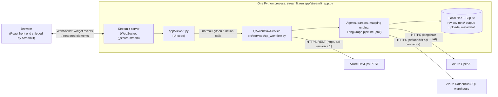
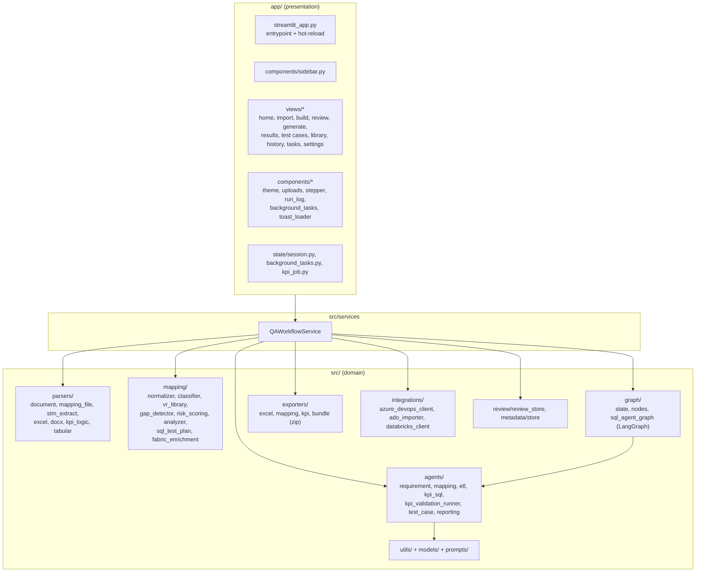
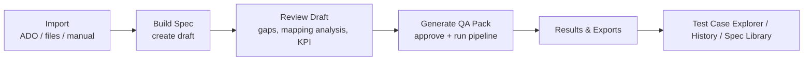
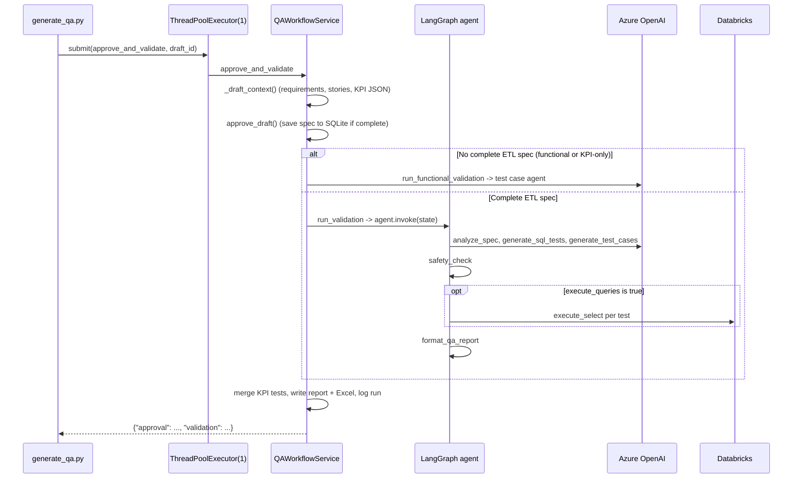
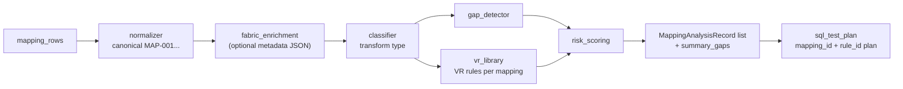
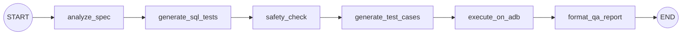

# QA Accelerator — Technical & Architecture Documentation

**AI-powered ETL and functional QA accelerator (Streamlit + LangGraph + Azure OpenAI + Azure Databricks)**

| Item | Detail |
|---|---|
| Document type | Technical / architecture reference (companion to `QA_Accelerator_Requirements_Document.md`, which is the product requirements document) |
| Audience | Developers, QA engineers, data engineers, reviewers |
| Basis | Written from the source code in this repository. Section 17 lists what is not implemented or not verified |
| Runtime | Python 3.11+, Streamlit, LangGraph, LangChain (`AzureChatOpenAI`), `databricks-sql-connector`, `httpx`, `openpyxl`, `python-docx`, `pypdf`, `pydantic` |

---

## Table of contents

1. [What the product does](#1-what-the-product-does)
2. [How the frontend talks to the backend](#2-how-the-frontend-talks-to-the-backend)
3. [Architecture](#3-architecture)
4. [Repository layout](#4-repository-layout)
5. [End-to-end workflow](#5-end-to-end-workflow)
6. [Workflow modes](#6-workflow-modes)
7. [Frontend (Streamlit app)](#7-frontend-streamlit-app)
8. [Service layer: `QAWorkflowService`](#8-service-layer-qaworkflowservice)
9. [Input parsers](#9-input-parsers)
10. [Mapping engine and the VR rule library](#10-mapping-engine-and-the-vr-rule-library)
11. [Agents and the LangGraph pipeline](#11-agents-and-the-langgraph-pipeline)
12. [SQL safety model](#12-sql-safety-model)
13. [External integrations](#13-external-integrations)
14. [Data model and persistence](#14-data-model-and-persistence)
15. [Configuration reference](#15-configuration-reference)
16. [Background tasks, activity log and hot reload](#16-background-tasks-activity-log-and-hot-reload)
17. [Known limitations and open issues](#17-known-limitations-and-open-issues)
18. [Setup, run, test and troubleshooting](#18-setup-run-test-and-troubleshooting)
19. [Extension guide](#19-extension-guide)

---

## 1. What the product does

The QA Accelerator turns project inputs into a reviewable draft and then into a QA pack.

**Inputs**

- Azure DevOps (ADO) user stories, including an attached mapping file.
- Requirement documents (`.txt`, `.docx`, `.pdf`).
- Source-to-target mapping (STM) documents (`.xlsx`, `.xlsm`, `.csv`, Word `.docx`).
- UI screenshots (optional).
- Developer KPI SQL documents (optional).
- A ready-made ETL spec JSON (optional).

**Outputs (the "QA pack")**

- Functional test cases and a traceability / coverage set.
- Read-only Databricks SQL validation tests (SELECT / WITH only).
- A Markdown report (`output/qa_validation_pack.md`).
- An Excel workbook (`output/qa_test_cases.xlsx`).
- A run record (`runs/<run-id>.json`) and an optional ZIP bundle.

A human reviews and approves the draft before the QA pack is generated. SQL is only executed against Databricks if the user ticks **Execute SQL on Azure Databricks**.

---

## 2. How the frontend talks to the backend

**Short answer: there is no separate backend server and no REST API.** The Streamlit process is both the frontend server and the backend. The "backend" is plain Python modules in `src/` that the UI imports and calls directly.



### 2.1 The request cycle

1. The browser opens `http://localhost:8501`. Streamlit serves its own front end and keeps a **WebSocket** open to the server.
2. Every click, text edit or upload is sent over that WebSocket as a widget event.
3. Streamlit **re-runs `app/streamlit_app.py` from top to bottom** for that session. Widget values are available through `st.session_state`.
4. `streamlit_app.py` calls `render_sidebar()` to find the selected page, then calls `PAGES[page]()` (`app/views/__init__.py`).
5. The view function runs normal Python. When a button is pressed (for example **Generate Draft**), it calls the service directly, for example `service.build_draft_from_files(...)`.
6. The service calls parsers and agents. Agents call Azure OpenAI over HTTPS. Results are written to disk and returned to the view.
7. The view renders the result with `st.markdown`, `st.dataframe`, `st.download_button` and so on. Streamlit sends only the changed elements back to the browser.

### 2.2 Where the "backend calls" actually happen

| Direction | Mechanism | Code |
|---|---|---|
| UI to business logic | In-process Python call | `app/views/*.py` → `get_service()` → `QAWorkflowService` (`app/state/session.py`) |
| Business logic to LLM | HTTPS via LangChain `AzureChatOpenAI` (Responses API, temperature 0) | `src/config.py::get_azure_llm`, `src/utils/llm_json.py::invoke_llm_json` |
| Business logic to Azure DevOps | HTTPS REST with a PAT in a Basic auth header | `src/integrations/azure_devops_client.py` |
| Business logic to Databricks | `databricks.sql.connect(...)` over HTTPS to a SQL warehouse | `src/integrations/databricks_client.py` |
| State between reruns | `st.session_state` (per browser session, in memory) | `app/state/session.py` |
| Durable state | JSON files and a SQLite database on the local disk | `src/review`, `src/metadata`, `src/utils/run_logger.py` |

### 2.3 How to see these calls while debugging

- **Browser to Streamlit:** Chrome DevTools → Network → WS → `_stcore/stream`. You will see protobuf frames, not REST calls. There are no `/api/...` URLs to find.
- **Streamlit to Azure OpenAI / ADO:** log in `src/utils/llm_json.py` and `src/integrations/azure_devops_client.py`, or use a proxy such as Fiddler or `mitmproxy`. Python 3.14 `httpx` honors `HTTP(S)_PROXY`.
- **Pipeline progress:** the in-app **Activity log** (sidebar) shows `logging` output from the nodes (`Analyzing ETL spec...`, `Safety check: N approved, M blocked`, and so on).

---

## 3. Architecture



**Design principles visible in the code**

- **Deterministic first, LLM second.** Mapping classification, VR rule assignment, risk scoring, gap detection and the SQL test *plan* are rule-based. The LLM fills in the *how* (actual SQL text) and the narrative.
- **Human in the loop.** Nothing is generated until a draft is reviewed and approved.
- **Read-only against data.** Two independent SQL guards (Section 12).
- **Same service for UI and CLI.** `main.py` and the Streamlit views both use `QAWorkflowService`.

---

## 4. Repository layout

```
app/                         Streamlit UI
  streamlit_app.py           Entry point, source-change fingerprint and module purge
  components/                Reusable widgets
    sidebar.py               Navigation groups, session status card, workflow progress
    theme.py                 Full CSS design system (Material 3 dark) + page loader + page_header()
    background_tasks.py      Bell, task panel, polling fragment
    run_log.py               In-memory activity log + sidebar popover
    toast_loader.py          Loader/toast around long operations
    file_upload.py           save_upload(), screenshot -> ui_context
    kpi_logic_upload.py      KPI document upload and normalization UI
    mapping_analysis.py      Mapping Agent output + JSON/Excel download buttons
    connection_status.py     Connection cards
    progress_stepper.py, story_card.py, export_buttons.py
  views/                     One module per sidebar page (see Section 7)
  state/
    session.py               Session defaults, service factory, QA job start/poll
    background_tasks.py      Task registry for the notification center
    kpi_job.py               KPI normalization job state
src/
  agents/                    requirement, mapping, etl, kpi_sql, kpi_validation_runner, test_case, reporting
  graph/                     LangGraph state, nodes, graph builder
  integrations/              Azure DevOps client + importer, Databricks client
  mapping/                   VR library, classifier, gap detector, risk scoring, analyzer, SQL test plan, enrichment
  models/                    Pydantic models: ETL spec, mapping analysis, test case
  parsers/                   document, mapping file, STM (Word), Excel/CSV, KPI logic, tabular helpers
  prompts/                   Prompt text per agent
  exporters/                 Excel, mapping, KPI, ZIP bundle
  inputs/json_loader.py      Load a JSON ETL spec
  review/review_store.py     Draft storage (JSON files)
  metadata/store.py          Approved spec + run storage (SQLite)
  services/qa_workflow.py    Orchestration used by the UI and the CLI
  utils/                     llm_json, sql_safety, workflow_mode, run_logger, output_paths
  config.py                  Environment-driven settings
main.py                      Optional CLI
venv_bootstrap.py            Re-launches the script under .venv
setup.ps1, run_ui.ps1, run_sample.ps1
samples/                     Sample BRD, mappings, specs, KPI, metadata
tests/                       pytest suite
docs/                        Documentation
```

Runtime folders created while using the app: `imports/ado/`, `uploads/`, `review/drafts/`, `runs/`, `output/`, `metadata/`.

---

## 5. End-to-end workflow



| Step | Page | What happens in code |
|---|---|---|
| 1. Import | `import_stories.py` | `service.import_from_azure_devops()` stores `imports/ado/<id>/` ; or file upload via `save_upload()`; or manual story → `build_draft_from_manual_story()` |
| 2. Build | `build_spec.py` | One of `build_draft_from_ado / _files / _json`, `build_functional_draft`. Creates a draft JSON in `review/drafts/` |
| 3. Review | `review_draft.py` | Shows gaps, assumptions, mapping analysis; edits the ETL JSON via `update_draft()`; attaches KPI logic via `attach_kpi_logic_to_draft()` |
| 4. Generate | `generate_qa.py` | `start_qa_generation()` submits `service.approve_and_validate()` to a background thread (Section 16) |
| 5. Results | `results_exports.py` | Shows the last result, report, Excel and ZIP downloads |

### 5.1 What `approve_and_validate` does



---

## 6. Workflow modes

`detect_workflow_mode()` in `src/utils/workflow_mode.py` picks a mode when the user leaves it on **auto**. It looks for ETL keywords (`etl`, `source table`, `target table`, `staging`, `data warehouse`, `incremental load`, `mapping`, `pipeline`) and UI keywords (`ui`, `screen`, `button`, `login`, `portal`, `dashboard`, `page`, `form`, `dropdown`, `modal`, `navigation`, `wireframe`, `mockup`, `insight studio`).

| Mode | Rule (simplified) | What gets generated |
|---|---|---|
| `etl` | Source and target tables identified, or a mapping with ETL keywords, and no UI keywords | ETL spec, mapping analysis (VR rules), SQL tests, test cases |
| `hybrid` | ETL signals **and** UI keywords; or a functional draft that gets a KPI logic document attached | Functional cases plus SQL (mapping and/or KPI) |
| `functional` | UI keywords or user stories without ETL tables/mapping | Functional/manual test cases. ETL spec is intentionally `{}` |

A draft is "complete" for the ETL path only when `source_table`, `target_table` and `primary_key` are all non-empty (`_is_complete_etl_spec`). Otherwise `approve_and_validate` takes the functional path.

---

## 7. Frontend (Streamlit app)

### 7.1 Entry point: `app/streamlit_app.py`

In order:

1. `ensure_project_venv()` re-launches under `.venv` if needed.
2. `st.set_page_config(layout="wide", ...)`.
3. **Source fingerprint.** It scans `src/` and `app/` for `.py` files (count + newest mtime). If the fingerprint changed, it deletes every `src.*` and `app.*` module from `sys.modules` and drops the cached `qa_service`, so edited code is picked up without restarting Streamlit.
4. `install_log_capture()`, `apply_theme()`, `init_session()`.
5. `get_service()` builds a `QAWorkflowService` and calls `install_mapping_parser()` (Section 9.3).
6. Sidebar: `render_sidebar()` returns the page name; `render_log_button()` adds the Activity log.
7. `poll_background_tasks()` and `render_background_tasks()` (the bell).
8. `PAGES[page]()` renders the selected view.

### 7.2 Pages (`app/views/__init__.py`)

| Sidebar label | Page key | Module | Purpose |
|---|---|---|---|
| Home | `Home` | `home.py` | Connection cards, counts, quick actions, recent runs |
| Import | `Import` | `import_stories.py` | ADO import, file upload, manual story, KPI SQL upload |
| Build Spec | `Build ETL Spec` | `build_spec.py` | Create a draft (Uploaded files, Latest ADO import, Sample files, ETL spec JSON) |
| Review | `Review Draft` | `review_draft.py` | Gaps, mapping analysis, JSON edit, KPI attach |
| Generate | `Generate QA Pack` | `generate_qa.py` | Approve and run the pipeline in the background |
| Exports | `Results & Exports` | `results_exports.py` | Download report, Excel, ZIP |
| Test Cases | `Test Case Explorer` | `test_cases.py` | Filter and inspect cases |
| Spec Library | `Spec Library` | `spec_library.py` | Approved specs; re-run via `service.run_validation()` |
| History | `Run History` | `run_history.py` | Past runs from `runs/` |
| Tasks | `Background Tasks` | `background_tasks.py` | Full task list page |
| Settings | `Settings` | `settings.py` | Connection checks and health |

### 7.3 Session state keys (defaults in `init_session`)

`current_page`, `draft_id`, `draft_spec_json`, `latest_ado_import`, `ado_work_item_ids`, `uploaded_mapping_path`, `uploaded_requirement_path`, `saved_upload_spec_name`, `build_input_source`, `last_validation_result`, `workflow_mode`, `ui_context`, `selected_run_id`, `kpi_logic_normalized`, `qa_generation_job`, `qa_service`, plus the background-task keys in Section 16.

### 7.4 Design system (`app/components/theme.py`)

A single CSS string injected with `st.markdown(..., unsafe_allow_html=True)`: Material 3 dark tokens (`--md-surface-*`, `--primary`, `--outline`, shape scale `--shape-xs..full`, motion curves `--spring`, `--ease-std`), the "Google Sans Flex" font, Material Symbols Rounded, custom buttons / inputs / expanders / tables, and a full-page loader overlay injected into the parent document through `components.html`. `page_header(title, caption)` renders the page heading.

---

## 8. Service layer: `QAWorkflowService`

`src/services/qa_workflow.py` is the one class the UI and CLI both use. It owns a `MetadataStore`, a `ReviewStore` and a `RunLogger`.

| Method | Purpose |
|---|---|
| `import_from_azure_devops()` | Build ADO settings, run `AdoImporter.import_user_stories()` |
| `build_draft_from_ado()` | Load an import, analyze requirements, detect mode, build a functional or ETL draft |
| `build_draft_from_files()` | Mapping file (+ optional requirement doc) → `analyze_requirements` → `parse_mapping_file` → `build_etl_spec` → draft |
| `build_draft_from_json()` | Load a JSON ETL spec as a draft |
| `build_functional_draft()` / `build_draft_from_manual_story()` | Functional drafts (empty ETL spec) |
| `process_kpi_logic_document()` | Parse → normalize with the KPI SQL agent → write raw/normalized JSON to `uploads/kpi_logic/` |
| `attach_kpi_logic_to_draft()` | Store KPI paths in `source_files`; upgrades functional → hybrid |
| `update_draft()` | Validate with `ETLSpecModel` when complete, then persist |
| `approve_draft()` | Save a complete spec to SQLite (versioned) and mark the draft approved |
| `approve_and_validate()` | Approve then run the ETL or functional pipeline (Section 5.1) |
| `run_validation()` | ETL pipeline: LangGraph, KPI merge, report, Excel, run log |
| `run_functional_validation()` | Functional + KPI pipeline without the SQL graph |
| `build_qa_pack_zip()` | ZIP bundle for download |

`_draft_context()` re-reads the requirement text, user stories and KPI JSON from the paths recorded in the draft's `source_files`, so a draft stays self-contained on disk.

---

## 9. Input parsers

### 9.1 Requirement documents

`src/parsers/document_parser.py::read_requirement_document` reads `.txt`, `.docx` and `.pdf` (`python-docx`, `pypdf`).

### 9.2 Mapping files

`src/parsers/mapping_file.py::parse_mapping_file(path)` dispatches by file type:

- `.docx` → `stm_extract.parse_stm_docx(path, write_excel=True)`. It reads **Source to Target Mapping (STM)** tables under entity headings (Heading 2 = target entity), keeps the **pseudo code** under each entity, ignores architecture tables (environments, lakehouses, tech stack, orchestrators) and writes a normalized Excel next to the Word file.
- `.xlsx`, `.xlsm`, `.csv` → `excel_mapping_parser.parse_mapping_tabular`. Headers are flexible (`Source Table`, `SOURCE_TABLE`, `Src Table`). Minimum columns: **Source Column** and **Target Column**.

The result is a payload with `mapping_rows`, `entity_logic`, `stm_entities`, `document_kind`, `normalized_excel_path`, and, when known, `source_table` / `target_table`.

Recommended CoE columns: Source Database, Source Schema, Source Table, Source Column, Source Data Type, Transformation, Target Database, Target Schema, Target Table, Target Column, Target Data Type, Business Rule, Nullable, Primary Key, Notes.

### 9.3 `install_mapping_parser()`

A compatibility shim. Streamlit keeps modules in memory, so after edits a stale parser could stay bound inside other modules. `install_mapping_parser()` rebinds `parse_mapping_workbook`, `parse_mapping_file`, `parse_mapping_docx` and `parse_stm_docx` on the live modules to the current functions. It is called each time `get_service()` runs.

### 9.4 KPI logic documents

`src/parsers/kpi_logic_parser.py` accepts `.sql`, `.xlsx`, `.csv`, `.txt`, `.docx`, `.pdf`, `.md`, `.json`. For tabular input it resolves columns through `KPI_HEADER_ALIASES` (`kpi_id`, `kpi_name`, `module`, `sql_query`, `expected_result`, `priority`). `sql_query` accepts headers such as `sql query`, `query`, `sql`, `logic`, `databricks sql`, `validation sql`, `kpi sql`. If no SQL column is found, it raises *"KPI logic sheet must include a SQL/Query column"*. Content-based SQL column detection is **not** implemented (Section 17).

---

## 10. Mapping engine and the VR rule library

The mapping engine in `src/mapping/` is deterministic and does not call the LLM.



### 10.1 Normalizer (`normalizer.py`)

Each parsed row becomes a canonical mapping with ID `MAP-001`, `MAP-002`, ..., split into `source` / `target` endpoints (database, schema, table, column, data type, nullable, primary key), a `transformation` block (`logic`, later `type`) and a `business_rule`. Blank fields become `UNKNOWN`. Table names carry forward from the previous row. `db.schema.table` strings are split into parts.

### 10.2 Classifier (`classifier.py`)

`classify_transformation(logic)` returns one of: `DIRECT`, `STRING_TRANSFORMATION`, `DATE_TRANSFORMATION`, `DEFAULT_VALUE`, `CONDITIONAL`, `CALCULATION`, `DATATYPE_CONVERSION`, `LOOKUP`, `JOIN`, `AGGREGATION`, `SCD`, `FILTER`, `COMPLEX_SQL`. It uses ordered regexes, for example: two or more `JOIN`s (or a join plus lookup) → `COMPLEX_SQL`; `scd|slowly changing|type 1/2` → `SCD`; `lookup|lkp` → `LOOKUP`; `hardcoded|constant` → `DEFAULT_VALUE`.

### 10.3 VR rule library (`vr_library.py`)

| ID | Type | Rule | Priority |
|---|---|---|---|
| VR01 | RECORD | Record existence | High |
| VR02 | NULL | NULL handling | High |
| VR03 | DUPLICATE | Duplicate / uniqueness | High |
| VR04 | DATATYPE | Data type compatibility | Medium |
| VR05 | LENGTH | Length | Medium |
| VR06 | PRECISION | Precision / scale | Medium |
| VR07 | FORMAT | Format | Medium |
| VR10 | TRANSFORMATION | Direct mapping | High |
| VR11 | TRANSFORMATION | Calculation | High |
| VR12 | TRANSFORMATION | String transformation | High |
| VR13 | TRANSFORMATION | Date transformation | High |
| VR14 | TRANSFORMATION | Conditional logic | High |
| VR15 | LOOKUP | Lookup | High |
| VR16 | JOIN | Join keys and cardinality | High |
| VR17 | AGGREGATION | Aggregation | High |
| VR18 | DEFAULT | Default value | Medium |
| VR19 | FILTER | Filter include/exclude | Medium |
| VR20 | LOAD | Full load | Medium |
| VR21 | LOAD | Incremental load | High |
| VR22 | LOAD | CDC | High |
| VR23 | SCD | SCD Type 1 | High |
| VR24 | SCD | SCD Type 2 | High |
| VR25 | LATE_ARRIVING | Late arriving data | Medium |
| VR26 | REJECT | Reject records | Medium |

(The library has no VR08 or VR09.) `TYPE_TO_RULES` maps each transformation type to its rules, for example `DIRECT → VR10, VR02, VR04, VR05`; `LOOKUP → VR15, VR02, VR03`; `SCD → VR23, VR24, VR02`.

`rules_for_mapping()` builds the rule set per mapping:

1. **VR01** is always added (every mapping gets a record-existence check).
2. The rules from `TYPE_TO_RULES` for the mapping's transformation type (unknown types fall back to VR10 + VR02).
3. **VR02** (High) when the target is non-nullable (`n`, `no`, `false`, `0`, `not null`, `mandatory`).
4. **VR03** (High) when the column is a primary key or the business rule says "unique".
5. **VR04** when both data types are known; **VR05** when the target is a `char/varchar`; **VR06** when the target is `decimal/numeric/number/double/float`.
6. **VR07** when the business rule mentions format, date, email, pattern or mask.
7. **VR26** when it mentions "reject" or "late"; **VR25** when it mentions "late".

Load-level rules come from `load_type_rules(load_type, incremental_column)`: `incremental → VR21`, `cdc → VR22`, `snapshot → VR20`, anything else → `VR20` (full load).

### 10.4 Gaps and risk

- `gap_detector.detect_gaps()` flags: missing source/target table or column, missing transformation logic, missing join condition (LOOKUP/JOIN/COMPLEX_SQL logic that mentions neither "join" nor "lookup"), missing business rule, missing source/target data type, potential source-target datatype mismatch (different type families: numeric, string, datetime), target length/precision risk (smaller `varchar(n)` or reduced `decimal(p,s)`), "ambiguous or overly complex transformation" for COMPLEX_SQL, and "missing incremental/CDC criteria" when the load type is `incremental` or `cdc` and no incremental column is given.
- `risk_scoring.score_risk()` starts from a base level per type (`DIRECT/STRING/DATE` Low; `DEFAULT/CONDITIONAL/FILTER` Medium; `CALCULATION/CONVERSION/LOOKUP/JOIN/AGGREGATION/SCD` High; `COMPLEX_SQL` Very High) and bumps it for datatype mismatch, complexity, missing information, primary keys and "unique" / "mandatory" rules. `requires_review()` is true for High, Very High, or any gap.
- Optional `fabric_enrichment` fills missing data type / nullability / PK from `FABRIC_METADATA_PATH` (default `samples/metadata/fabric_columns.json`) and flags datatype mismatches.

### 10.5 SQL test plan (`sql_test_plan.py`)

`build_sql_test_plan(mapping_analysis, spec, catalog)` turns every approved `mapping_id + rule_id` pair into a plan item (`what_to_test`, `validation_type`, qualified table names) using `RULE_VALIDATION_TYPE` (for example VR01/VR20 → *Record Count*, VR02 → *NULL*, VR03 → *Duplicate*, VR15/VR16 → *Data Reconciliation*, VR21/VR22 → *Incremental Load*). At most `LLM_PLAN_LIMIT = 40` items go to the LLM. `merge_plan_with_llm_tests()` merges by `mapping_id` / `rule_id` and reports plan items that received no SQL as "uncovered" gaps. Identifier quoting uses backticks when needed (`quote_ident`).

---

## 11. Agents and the LangGraph pipeline

| Agent | File | Responsibility |
|---|---|---|
| Requirement Agent | `agents/requirement_agent.py` | Facts, rules, gaps from BRD/ADO text. Returns an empty-analysis stub when no text is given |
| Mapping Agent | `agents/mapping_agent.py` | LLM-enriches mapping rows per target entity, then builds the ETL spec; combines with the deterministic mapping analysis |
| ETL Agent | `agents/etl_agent.py` | Coverage planning over the manager-defined ETL test categories (schema, reconciliation, data quality, transformation, business rule, incremental, SCD, negative/boundary, regression, ...) |
| KPI SQL Agent | `agents/kpi_sql_agent.py` | Normalizes developer KPI SQL to Databricks SELECT, in batches of 8; unrunnable SQL goes to `rejected_queries` |
| KPI validation runner | `agents/kpi_validation_runner.py` | Functional cases + KPI SQL tests + safety check (+ execution) without the SQL graph |
| Test Case Agent | `agents/test_case_agent.py` | Functional cases and artifacts (RTM, coverage matrix, automation recommendations); also wraps SQL tests as structured cases |
| Reporting Agent | `agents/reporting_agent.py` | Markdown QA report and execution summary |

### 11.1 Mapping Agent (`build_etl_spec`)

1. `enrich_mapping_output_with_llm()` groups rows by target table and calls the LLM once per entity (`MAPPING_OUTPUT_PROMPT`) for logic, keys, load type and rules; LLM failures are recorded in `missing_information` and the rows are kept.
2. `analyze_mappings()` runs the deterministic engine (Section 10).
3. A second LLM call (`MAPPING_AGENT_PROMPT`) produces the ETL spec. For more than `PROMPT_MAPPING_LIMIT = 80` mappings only a per-entity sample is sent; the full canonical mappings are attached afterwards. Pseudo code is truncated to `PSEUDO_CODE_LIMIT = 12000` characters.
4. `apply_canonical_spec()` fills `source_table`, `target_table`, `primary_key` (`UNKNOWN` if absent, with a note), rules, and replaces a short LLM column list with the full canonical rows.
5. The result is validated with `ETLSpecModel`.

### 11.2 The SQL LangGraph (`src/graph/sql_agent_graph.py`)



| Node | What it does |
|---|---|
| `analyze_spec` | Builds the SQL test plan from the mapping analysis, builds the ETL Agent plan, asks the LLM for `validation_plan`, `missing_information`, `assumptions`, `analyst_notes` |
| `generate_sql_tests` | Gives the LLM the plan; the LLM writes SQL; `merge_plan_with_llm_tests` aligns tests to plan items |
| `safety_check` | Drops any test that is not SELECT-only (runs **before** test cases are built, so blocked SQL does not appear in cases) |
| `generate_test_cases` | Functional cases (when requirement context exists) plus structured cases from SQL tests |
| `execute_on_adb` | Optionally runs queries on Databricks (Section 12.3) |
| `format_qa_report` | Writes the Markdown report |

All LLM calls go through `invoke_llm_json()`, which appends "Respond with valid JSON only", strips Markdown fences, extracts the first `{...}` block if needed and retries up to 2 more times on bad JSON. `coerce_text()` / `coerce_str_list()` normalize fields the model returns as lists instead of strings (this fixed the earlier `sequence item N: expected str instance, list found` error).

---

## 12. SQL safety model

Three independent protections apply to generated SQL.

1. **Static check before anything is shown or run** (`src/utils/sql_safety.py`, used by the `safety_check` node and for KPI SQL):
   - Must start with `SELECT` or `WITH`.
   - Must not contain, as whole words: `DELETE`, `UPDATE`, `DROP`, `TRUNCATE`, `ALTER`, `INSERT`, `MERGE`, `CREATE`, `GRANT`, `REVOKE`, `EXEC`, `EXECUTE`.
   - Empty SQL is rejected. Rejection reasons are kept in `rejected_queries`.
2. **Placeholder guard.** SQL containing `${...}` (for example `${last_watermark_ts}`) is **skipped** at execution with a clear message, never sent to Databricks.
3. **Execution guard** (`integrations/databricks_client.py::_assert_select_only`) re-checks right before executing, and also forbids `COPY`, `PUT`, `REMOVE`. Only `cursor.fetchmany(preview_rows + 1)` is read, so output is bounded by `DATABRICKS_PREVIEW_ROWS` (default 20).

### 12.1 Execution statuses

| Status | Meaning |
|---|---|
| `SKIPPED` | Execution unticked, dummy Databricks credentials, or unresolved placeholders |
| `PASS` / `FAIL` | Expectation text implies "0 rows / no rows / empty": `PASS` if the preview row count is 0, else `FAIL`. A **truncated** result that would pass is downgraded to `FAIL` |
| `EXECUTED` | Ran successfully, no zero-row expectation to compare against |
| `ERROR` | Databricks raised an exception (message stored) |

### 12.2 Dummy-credential detection

`DatabricksSettings.is_dummy` is true when host, HTTP path or token is empty, the token contains "dummy", or the host contains `xxxxxxxxxxxx`. `get_azure_llm()` refuses endpoints/keys that look like placeholders.

### 12.3 What is not guarded

The static check is regex based. It is a safety net, not a SQL parser: a destructive keyword inside a string literal or comment would also cause a block (fail-closed), but the check does not prove read-only semantics for exotic constructs. Databricks permissions on the token remain the real enforcement and should be read-only.

---

## 13. External integrations

### 13.1 Azure OpenAI

`get_azure_llm()` returns `AzureChatOpenAI(azure_endpoint, api_key, azure_deployment, api_version, temperature=0, use_responses_api=True)`. Required: `AZURE_OPENAI_ENDPOINT`, `AZURE_OPENAI_API_KEY`; deployment defaults to `gpt-5.1`.

### 13.2 Azure DevOps

`AzureDevOpsClient` (`httpx`, PAT sent as `Authorization: Basic base64(":PAT")`, `api-version=7.1`):

| Call | Endpoint |
|---|---|
| `test_connection()` | `GET {org}/_apis/projects` (also checks the configured project exists) |
| `query_user_stories()` | `POST {org}/{project}/_apis/wit/wiql` (WIQL built by `AzureDevOpsSettings.build_wiql()`; specific IDs, or type/state/area/iteration filters) |
| `get_work_items(ids)` | `GET .../_apis/wit/workitems?ids=...&fields=...`, then a per-item `GET ...?$expand=relations` (ADO rejects `$expand` together with `fields`) |
| `download_attachment(url)` | `GET` the attachment URL (used for the mapping file) |

A 401 gives a message to rotate the PAT. `AdoImporter` strips HTML from fields, writes `requirements_from_ado.txt`, `user_stories.json`, optional `mapping.xlsx`, `import_metadata.json` under `imports/ado/<import-id>/`, and updates `imports/ado/latest.json`.

### 13.3 Azure Databricks

`databricks.sql.connect(server_hostname, http_path, access_token, catalog, _socket_timeout=DATABRICKS_QUERY_TIMEOUT_SECONDS)`. A new connection is opened per query. Execution is off by default and only needed to run the generated SQL.

---

## 14. Data model and persistence

### 14.1 ETL spec (`ETLSpecModel`)

| Field | Notes |
|---|---|
| `database_dialect` | Default `Databricks SQL` |
| `catalog` | Default `main` |
| `source_table`, `target_table`, `primary_key` | Required, non-empty after strip |
| `load_type` | `full` / `incremental` / `snapshot` / `cdc` (free text allowed) |
| `incremental_column`, `watermark_column` | Optional |
| `source_to_target_mapping` | List of `{source_column, target_column, transformation}` |
| `transformation_rules`, `business_rules`, `not_null_columns` | Lists |
| `additional_notes` | Text |

### 14.2 Draft (`review/drafts/<draft-id>.json`)

`draft_id`, `status` (`pending_review` → approved), `created_at`, `updated_at`, `requirement_summary`, `mapping_rows`, `mapping_analysis`, `canonical_mappings`, `entity_logic`, `stm_entities`, `llm_mapping_output`, `etl_spec_draft`, `missing_information`, `assumptions`, `source_files` (paths, `spec_name`, `workflow_mode`, `ui_context`, KPI paths, ADO import ID).

### 14.3 SQLite (`metadata/qa_accelerator.db`)

| Table | Purpose |
|---|---|
| `etl_specs` | `id`, `name`, `version`, `content_json`, timestamps, `UNIQUE(name, version)`. Saving the same name creates the next version |
| `schema_registry` | `table_fqn` → `columns_json` (reserved for discovered schemas) |
| `validation_runs` | `spec_id`, `run_at`, `summary_json`, `report_path` |

### 14.4 Run record (`runs/<run-id>.json`)

`run_id`, `run_at`, `spec_id`, `spec_name`, `source_table`, `target_table`, `test_count`, `test_case_count`, `execution_summary` (status counts), `report_path`, `test_cases_path`, `rejected_queries`.

### 14.5 Test case (`StructuredTestCase`)

Core: `test_id`, `title`, `validation_type`, `priority`, `preconditions`, `test_steps`, `expected_result`, `sql_query`, `traceability`. Functional extras: `requirement_id`, `module`, `feature`, `test_scenario`, `test_case_description`, `test_data`, `severity`, `test_type` (`Data Validation`, `KPI Data Validation`, functional types), `positive_negative`, `automation_candidate`, `automation_reason`, `execution_steps[]`.

### 14.6 Output files

| Output | Location | Notes |
|---|---|---|
| QA report | `output/qa_validation_pack.md` | Overwritten each run (`safe_write_text`) |
| Test cases | `output/qa_test_cases.xlsx` | Overwritten each run; includes mapping analysis and gaps sheets for ETL runs. Close it in Excel before regenerating |
| ZIP bundle | in-memory download | `run_summary.json`, report, Excel, `etl_spec.json`, `test_case_artifacts.json` |
| Mapping Agent output | download buttons | JSON or Excel (Mapping Rows, Canonical Mappings, Analysis, Gaps, ETL Spec mapping, Pseudo Code) |
| KPI JSON | `uploads/kpi_logic/<name>_raw.json`, `_normalized.json` | |

---

## 15. Configuration reference

All settings are read from environment variables. `src/config.py` calls `load_dotenv()` at import time, so copy `.env.example` to `.env` and restart (or let the hot-reload pick it up on the next source change; a changed `.env` alone does not change the fingerprint).

| Variable | Required | Default | Used for |
|---|---|---|---|
| `AZURE_OPENAI_ENDPOINT` | Yes | | LLM endpoint |
| `AZURE_OPENAI_API_KEY` | Yes | | LLM key |
| `AZURE_OPENAI_DEPLOYMENT` | | `gpt-5.1` | Deployment name |
| `AZURE_OPENAI_API_VERSION` | | `2025-01-01-preview` in code (`.env.example` shows a newer one) | API version |
| `AZURE_OPENAI_MODEL` | | | Listed in `.env.example` |
| `DATABRICKS_SERVER_HOSTNAME` | Only to execute SQL | | Warehouse host |
| `DATABRICKS_HTTP_PATH` | Only to execute SQL | | Warehouse HTTP path |
| `DATABRICKS_ACCESS_TOKEN` | Only to execute SQL | | Token (use a read-only principal) |
| `DATABRICKS_CATALOG` | | `main` | Default catalog |
| `DATABRICKS_SOURCE_SCHEMA` / `DATABRICKS_TARGET_SCHEMA` | | `stg` / `dw` | Passed to prompts as context |
| `DATABRICKS_QUERY_TIMEOUT_SECONDS` | | `120` | Socket timeout |
| `DATABRICKS_PREVIEW_ROWS` | | `20` | Rows fetched per query |
| `AZURE_DEVOPS_ORG`, `AZURE_DEVOPS_PROJECT`, `AZURE_DEVOPS_PAT` | Only for ADO import | | ADO access (PAT needs **Work Items: Read**) |
| `AZURE_DEVOPS_AREA_PATH`, `AZURE_DEVOPS_ITERATION_PATH` | | | WIQL filters |
| `AZURE_DEVOPS_WORK_ITEM_IDS` | | | Comma-separated IDs; takes precedence over filters |
| `AZURE_DEVOPS_WORK_ITEM_TYPES` | | `User Story` | Types to query |
| `AZURE_DEVOPS_MAX_STORIES` | | `25` | Cap |
| `AZURE_DEVOPS_TIMEOUT_SECONDS` | | `60` | HTTP timeout |
| `FABRIC_METADATA_PATH` | | `samples/metadata/fabric_columns.json` | Optional column metadata |

`get_connection_status()` powers the Home and Settings cards. It treats values containing `dummy`, `your-` or `xxxxxxxx` as not configured.

> `.env` holds secrets. It is gitignored. Do not paste its contents into chats or tickets.

---

## 16. Background tasks, activity log and hot reload

### 16.1 Background QA generation (`app/state/session.py`)

- `start_qa_generation()` refuses to start when a job is still running (`RuntimeError`), creates a `ThreadPoolExecutor(max_workers=1)` stored in `st.session_state["qa_generation_executor"]`, submits `service.approve_and_validate(...)`, and stores a job dict in `st.session_state["qa_generation_job"]`: `future`, `draft_id`, `started_at`, `include_functional`, `include_sql`.
- `poll_qa_generation_job()` runs on every rerun. When the future is done and not yet processed it applies the *Include functional* / *Include SQL* filters, calls `set_validation_result()`, sets `status` to `complete` or `failed` (with `error`), and raises a toast once.
- The Generate button is disabled while a job is running. The sidebar status card shows **Running in background**, **Ready to review** or **Failed**.
- This is **session-scoped and in-memory**: it survives page navigation and Streamlit reruns, but not a server restart, and there is no shared queue across users.

### 16.2 Notification center (bell, top right)

Files: `app/components/background_tasks.py`, `app/state/background_tasks.py`, `app/views/background_tasks.py`, CSS in `theme.py`.

- A 48px bell with a badge showing active (running + queued) tasks; the badge pulses while a task runs; tooltip "Background Tasks".
- A dropdown panel (about 400px wide, max 520px high, Material 3 dark surfaces) with a summary (Active / Completed / Failed), task rows (icon, name, status chip, description, timestamp, linear progress), expandable details, **Retry** for failed, **Dismiss** for completed, **Cancel** with a confirm step, **Clear completed**, and **View all tasks** (opens the `Background Tasks` page). Empty state: "You're all caught up". Mobile uses a bottom-sheet layout; `prefers-reduced-motion` disables the animations.
- `@st.fragment(run_every="1s")` polls the QA job, syncs it into the task registry (`sync_qa_generation_task`, progress is an *estimate* that approaches 92% over time, jumps to 100% on completion) and ticks demo tasks.
- **Demo tasks** (Generating Report, Uploading Files, Processing Dataset, Sending Notifications) are shown only when no live task is active, so the panel is never empty during design review. They are controlled by `background_tasks_include_demo` (default `True`).
- The task registry is a small abstraction (`BackgroundTask` dataclass, `upsert_task`, `get_tasks`, `dismiss_task`, ...) so a WebSocket/SSE/polling source can feed it later.

### 16.3 Activity log (`app/components/run_log.py`)

`install_log_capture()` attaches an in-memory log handler; the sidebar **Activity log** popover shows the buffer, and `generate_qa.py` can show live logs while running. This is separate from the bell.

### 16.4 Hot reload fingerprint

See Section 7.1 step 3. A change in the number or newest modification time of `.py` files under `src/` or `app/` purges all `src.*` and `app.*` modules from `sys.modules`. This prevents "I fixed it but the same error still happens" caused by Streamlit's cached modules.

---

## 17. Known limitations and open issues

| # | Item | Detail |
|---|---|---|
| 1 | **`maximum recursion depth exceeded` on Generate Draft** | Reported with `etl_spec.json` + `mapping_document.xlsx` on the Build Spec page ("Uploaded files"). **Root cause not yet identified.** Reproduce with the two files and read the traceback in the Activity log or terminal; the loop is somewhere in the draft path (`build_draft_from_files` → parsers / `build_etl_spec`) or in `install_mapping_parser()` rebinding functions to wrappers that call each other |
| 2 | No authentication or multi-user isolation | Single-user workspace; state is per Streamlit session; files are shared on disk |
| 3 | Background jobs are in memory | Lost on restart; one job per session; no shared queue |
| 4 | Estimated, not real, progress | The QA task progress is a time-based estimate; the pipeline does not report real step progress to the UI |
| 5 | Demo tasks in the bell | Enabled by default; set `background_tasks_include_demo = False` for production |
| 6 | *Include SQL validation tests* off | The pipeline still generates SQL; the SQL tests are removed from the result afterwards (`poll_qa_generation_job`), so LLM work is not saved |
| 7 | KPI SQL column detection | Header aliases only; content-based auto-detection of the SQL column is not implemented |
| 8 | Duplicate KPI merge logic | KPI merging exists in both `QAWorkflowService.run_validation` and `kpi_validation_runner` |
| 9 | Outputs overwrite | `output/qa_*.{md,xlsx}` are fixed names; a run history entry points to the latest file, not a per-run copy |
| 10 | Functional cases are not executed | Cases are for manual or later automated execution; nothing pushes them to ADO Test Plans |
| 11 | Regex SQL guard | Section 12.3 |
| 12 | Cloud deploy is not ready | `venv_bootstrap` exits when `.venv` is missing, and secrets are read from `.env` only (no `st.secrets` mapping) |
| 13 | `AZURE_OPENAI_API_VERSION` default mismatch | Code default `2025-01-01-preview`, `.env.example` suggests a newer version |

---

## 18. Setup, run, test and troubleshooting

### 18.1 Setup and run (Windows PowerShell)

```powershell
.\setup.ps1                 # creates .venv and installs requirements.txt
copy .env.example .env      # then fill in the values
.\run_ui.ps1                # streamlit run app\streamlit_app.py  ->  http://localhost:8501
.\run_sample.ps1            # sample demo run
```

### 18.2 CLI (optional)

```powershell
python main.py ado-test
python main.py ado-import [--build]
python main.py build --from-ado
python main.py build --use-samples
python main.py build --mapping <xlsx> --requirements <txt>
python main.py review --draft-id <id>
python main.py approve --draft-id <id> --no-execute
python main.py validate --spec samples/specs/sample_etl_spec.json --no-execute
python main.py list-specs
python main.py list-drafts
```

### 18.3 Tests

```powershell
.\.venv\Scripts\python.exe -m pytest
```

Test modules cover: Azure DevOps, background task registry, document / DOCX / Excel / KPI parsers, ETL agent, functional draft, LLM field coercion and JSON parsing, mapping agent, mapping analysis and exporter, metadata store, review store, SQL safety, SQL test plan, test case agent, workflow mode, KPI SQL agent. Use the project `.venv` interpreter; the system Python may not have `pytest`.

### 18.4 Troubleshooting

| Symptom | Likely cause and fix |
|---|---|
| "Azure OpenAI dummy values detected" | Endpoint/key still placeholders in `.env` |
| `sequence item N: expected str instance, list found` | LLM returned a list for a text field. Fixed with `coerce_text` / `coerce_str_list`; make sure Streamlit reloaded (the fingerprint purge does this) |
| ADO 401 | PAT expired or wrong scope. Create a PAT with **Work Items (Read)** and restart |
| ADO import returns 0 stories | Wrong IDs, area/iteration path or work item type |
| "Databricks table not found" | Leave execution unticked, or point at real Unity Catalog tables |
| Cannot write Excel | Close `output/qa_test_cases.xlsx` |
| `source_table / target_table / primary_key missing` | A functional draft has an empty spec on purpose. Add a mapping and rebuild as ETL/hybrid |
| Same error after editing code | Reload the page; the hot-reload fingerprint should purge stale modules |
| `maximum recursion depth exceeded` | See Section 17, item 1 |
| `uv trampoline failed` | Re-run `.\setup.ps1` |

---

## 19. Extension guide

**Add a page.** Create `app/views/<name>.py` with `render()`, register it in `PAGES` (`app/views/__init__.py`), and add an entry in `NAV_GROUPS` (`app/components/sidebar.py`).

**Add a validation rule.** Add `VRnn` to `VR_LIBRARY`, map it in `TYPE_TO_RULES` and/or `rules_for_mapping()`, add its validation type to `RULE_VALIDATION_TYPE` (`sql_test_plan.py`), and update the SQL prompt in `src/prompts/sql_prompts.py` if needed.

**Add a transformation type.** Extend `classifier.py`, `RISK_BY_TYPE`, and `TYPE_TO_RULES`.

**Add a graph node.** Write `def node(state: AgentState) -> AgentState` in `src/graph/nodes.py`, add keys to `AgentState` (`graph/state.py`), register it and its edges in `build_qa_sql_agent()`.

**Add an input format.** Add a parser under `src/parsers/`, dispatch it from `parse_mapping_file()` or `read_requirement_document()`, and add a test.

**Add a real background source.** Implement a producer that calls `upsert_task(BackgroundTask(...))` from `app/state/background_tasks.py` (polling, SSE or WebSocket), and replace the time-based estimate in `sync_qa_generation_task()` with real step events. For production multi-user use, move the work to a persistent queue (Celery, Azure Service Bus, Azure Functions, Databricks Jobs, a database job table).

**Expose a real API.** Because logic lives in `QAWorkflowService`, a FastAPI layer can wrap it without touching agents: for example `POST /drafts`, `POST /drafts/{id}/approve`, `GET /runs/{id}`. The Streamlit app would then call that API instead of the service directly.
